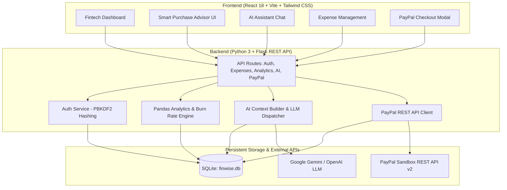

# FinWise AI – Smart Financial Assistant
> **AI-Powered Personal Finance & PayPal Sandbox Integration**  
> *Built for the PayPal AI Hackathon | Empowering Students & Young Professionals*

[](https://www.python.org/)
[](https://flask.palletsprojects.com/)
[](https://react.dev/)
[](https://tailwindcss.com/)
[](https://developer.paypal.com/)
[-brightgreen.svg)]()

---

## 🌟 Executive Summary

**FinWise AI** is a production-grade personal finance application specifically architected for university students and early-career young professionals. Managing income from stipends, part-time jobs, and entry-level salaries can be stressful; impulse purchases frequently push budgets off-track.

FinWise AI solves this through an end-to-end financial loop:
1. **Tracks & Analyzes:** Gathers income, expenses, and monthly category budgets in SQLite with Pandas-powered data analytics.
2. **Evaluates Affordability:** The **Smart Purchase Advisor** calculates an Affordability Score (0–100), evaluating daily burn rates, category limits, and need vs. want factors using *actual stored financial data*.
3. **Executes Payments:** Seamlessly connects to **PayPal Sandbox**, creating and capturing orders entirely server-side.
4. **Auto-Reconciles:** Upon verified capture, transactions are automatically added to the user's expense ledger, updating charts, burn rates, and AI context in real-time.

---

## 🏗️ System Architecture



---

## 🚀 Key Features

### 1. 📊 Financial Intelligence Dashboard
- **Executive Metrics:** Total Income, Total Expenses, Remaining Budget, and Savings Rate with visual progress indicators.
- **Spending Velocity & Burn Rate:** Tracks average daily burn rate ($/day) and projects month-end spending against your overall monthly limit.
- **Interactive Recharts Trends:** 6-month historical Income vs. Expense comparison.
- **Category Donut Chart:** Visual breakdown of spending by category with active budget meters.
- **Automated Alerts:** Identifies categories approaching or exceeding their monthly allocations.

### 2. 💸 Complete Expense Management
- Full CRUD operations (Add, Edit, Delete) for transactions.
- Multi-dimensional filtering by Month, Category, Payment Method, and search text.
- **Monthly Category Budget Allocation:** Customize monthly limits for Food, Rent, Tech, Transportation, Entertainment, Subscriptions, and more.
- Color-coded badges for payment methods, with prominent indicators for PayPal transactions.

### 3. 🧠 Ground-Truth AI Financial Assistant
- **Real-Time Data Injection:** Rather than hallucinating or using generic templates, FinWise AI queries actual SQLite records and Pandas summaries to answer user questions with real figures.
- **Configurable LLM Engine:** Seamlessly connects with Google Gemini (`gemini-1.5-flash`), OpenAI (`gpt-4o-mini`), or the built-in Pandas Financial Intelligence engine if no external API key is provided.
- **Actionable Advice:** Provides practical savings recommendations, identifies top spending drivers, and includes educational financial disclaimers.

### 4. 🎯 Smart Purchase Advisor
- **Affordability Analysis:** Enter any intended item, price ($), category, and whether it is a "Need" or "Want".
- **Affordability Score (0–100):** Considers:
  - Remaining monthly disposable income.
  - Category budget headroom before and after purchase.
  - Burn rate impact (how many days of typical spending this price represents).
  - Need vs. Want urgency factor.
- **Verdict & Rationale:** Provides clear badges (*Recommended*, *Affordable with Caution*, *Not Recommended*) with detailed mathematical explanations.
- **PayPal Sandbox Launchpad:** One-click transition directly into PayPal checkout.

### 5. 🛡️ Secure PayPal Sandbox Integration
- **Server-Side Security:** PayPal Client Secrets are **never** exposed to client browsers.
- **Order Creation (`POST /api/paypal/create-order`):** Flask backend interacts with `https://api-m.sandbox.paypal.com/v2/checkout/orders` to generate verified orders with intent `CAPTURE`.
- **Payment Capture & Verification (`POST /api/paypal/capture-order`):** Server captures the order and validates `status == 'COMPLETED'` before logging.
- **Duplicate Protection:** Prevents duplicate capture requests.
- **Auto-Ledger Recording:** Automatically inserts a matching transaction into the SQLite `transactions` table under the relevant category, tagged with the PayPal Order and Capture IDs.
- **Zero-Setup Demo Capability:** If PayPal API credentials are not yet configured in `.env`, the backend provides a built-in sandbox simulator, allowing judges to test the entire UI and payment reconciliation loop immediately!

---

## 💻 Tech Stack

| Layer | Technologies |
| :--- | :--- |
| **Frontend** | React 18, Vite 6, Tailwind CSS 3, Recharts 2, Lucide React, @paypal/react-paypal-js |
| **Backend** | Python 3.15, Flask 3.1, Flask-CORS, Requests, Python-Dotenv, Werkzeug |
| **Data Processing** | Pandas 3.1, NumPy 2.5 |
| **Database** | SQLite 3 (parameterized queries, foreign keys, indexing) |
| **AI Integration** | Google Gemini API (`v1beta`), OpenAI Chat Completions, Built-in Pandas Engine |
| **Payments** | PayPal REST API (Sandbox v1/oauth2, v2/checkout/orders) |
| **Testing** | Python `unittest` (14 automated unit & end-to-end integration tests) |

---

## ⚡ Quickstart & Installation

### Prerequisites
- Python 3.10+ (tested on Python 3.15.2)
- Node.js 18+ (tested on Node.js 26.13.0)

### 1. Clone the Repository
```bash
git clone https://github.com/your-username/finwise-ai.git
cd finwise-ai
```

### 2. Configure Environment Variables
Copy the example `.env.example` file to `.env`:
```bash
cp .env.example .env
```
Edit `.env` with your preferred credentials (optional for testing; sensible sandbox defaults are pre-configured):
```ini
FLASK_ENV=development
PORT=5000
SECRET_KEY=finwise_super_secret_jwt_key_hackathon_2026

# PayPal REST API Sandbox
PAYPAL_MODE=sandbox
PAYPAL_CLIENT_ID=your_paypal_sandbox_client_id_here
PAYPAL_CLIENT_SECRET=your_paypal_sandbox_client_secret_here

# AI / LLM Configuration
AI_PROVIDER=gemini
GEMINI_API_KEY=your_gemini_api_key_here
GEMINI_MODEL=gemini-1.5-flash
```

### 3. Install Backend Dependencies
```bash
python -m pip install -r requirements.txt
```

### 4. Build the Frontend
```bash
cd frontend
npm install
npm run build
cd ..
```

### 5. Launch the Application
Start the Flask backend (which simultaneously serves the REST API and the compiled React frontend):
```bash
python -m backend.app
```
Open your browser and navigate to:
👉 **`http://127.0.0.1:5000`**

*(Optional)* For frontend development with hot module reloading:
```bash
cd frontend
npm run dev
```
Accessible at `http://127.0.0.1:5173` (proxies API requests to Flask on port 5000).

---

## 🧪 Running the Test Suite

The project includes 14 comprehensive unit and end-to-end integration tests:
```bash
python -m unittest discover -s backend/tests -p "test_*.py"
```

### Test Coverage Highlights:
- ✅ **API Health & Frontend Delivery:** Verifies root endpoint serves React SPA and `/api/health` reports healthy.
- ✅ **Authentication:** Validates secure registration, login, and PBKDF2 password checks.
- ✅ **Expense CRUD:** Tests creation, retrieval, filtering, updates, and deletion.
- ✅ **Pandas Analytics:** Tests ground-truth financial summary, burn rates, and multi-month trends.
- ✅ **AI Ground-Truth Chat:** Verifies AI responses reference live financial figures and include disclaimers.
- ✅ **Smart Purchase Advisor:** Validates score calculation and metrics.
- ✅ **PayPal Order & Capture Lifecycle:** Verifies order creation, capture, duplicate prevention, and automated expense insertion.

---

## 📡 REST API Reference

| Endpoint | Method | Description |
| :--- | :---: | :--- |
| `/api/health` | `GET` | Health check and configuration status |
| `/api/auth/login` | `POST` | Authenticate user and issue session token |
| `/api/auth/register` | `POST` | Register a new user |
| `/api/analytics/summary` | `GET` | Get income, expenses, balance, savings rate, burn rate |
| `/api/analytics/categories`| `GET` | Category breakdown and budget adherence |
| `/api/analytics/trends` | `GET` | Multi-month historical spending trends |
| `/api/expenses` | `GET` | List transactions with filters (month, category, search) |
| `/api/expenses` | `POST` | Record a new expense or income entry |
| `/api/expenses/<id>` | `PUT` | Update an existing transaction |
| `/api/expenses/<id>` | `DELETE`| Remove a transaction |
| `/api/budgets` | `GET` | Retrieve category budgets for selected month |
| `/api/budgets` | `POST` | Upsert monthly budget allocation |
| `/api/ai/chat` | `POST` | Conversational financial query grounded in real data |
| `/api/ai/evaluate-purchase`| `POST`| Smart Purchase Advisor affordability evaluation |
| `/api/paypal/config` | `GET` | Safe PayPal Sandbox public configuration |
| `/api/paypal/create-order` | `POST` | Server-side PayPal REST order creation |
| `/api/paypal/capture-order`| `POST` | Server-side PayPal REST capture and verification |
| `/api/paypal/transactions` | `GET` | List verified PayPal transactions |

---

## 👤 Demo User & Sample Data

Upon first run, the SQLite database (`backend/data/finwise.db`) is automatically initialized with rich seed data:
- **Demo User:** `alex_student`
- **Email:** `alex@example.com`
- **Password:** `Password123!`
- **Monthly Income:** `$3,200.00`
- **Transactions:** 26 realistic transactions spanning the past 60 days across groceries, transit, dining, utilities, subscriptions, and tech.
- **Category Budgets:** Pre-configured monthly allocations for students and young professionals.

---

## ⚖️ Hackathon Compliance & Disclaimer

- **Sandbox Environment:** All payment interactions run against PayPal's Developer Sandbox (`https://api-m.sandbox.paypal.com`). No real financial funds or live credit cards are charged.
- **Financial Disclaimer:** FinWise AI is designed as an educational budgeting and assistance tool. Suggestions provided by the AI assistant do not constitute certified professional financial or investment advice.
- **Data Privacy:** User financial metrics are stored locally in the application's SQLite database; no credentials or private customer balances are exposed.

---

## 📄 License
This project is licensed under the MIT License. Built for the PayPal AI Hackathon.
